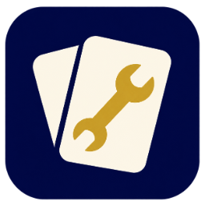
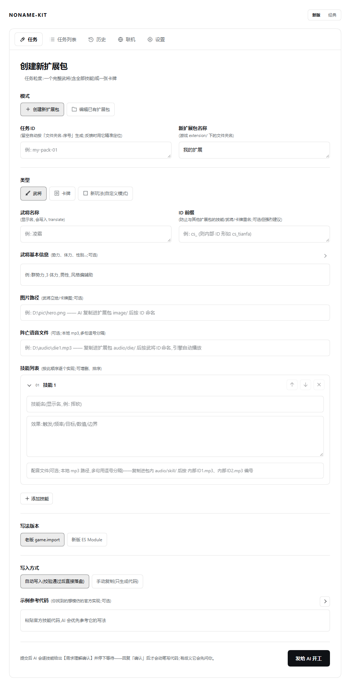

# dsh-noname-kit



无名杀扩展开发工坊，为 DeepSeek Harness 提供武将、卡牌和自定义模式开发工具。

- 搜索本地游戏源码，读取和修改已有扩展。
- 写入前检查语法和改动范围，覆盖源码前自动备份。
- 在任务列表确认效果、提交反馈，复制图片、配音和视频。
- 通过联机助手建房、检查扩展差异，并在客机同意后补传文件。



## 安装

**桌面版**：打开「插件」→「添加插件」，输入 `dsh-noname-kit` 安装。

**Web 版**：

```sh
dsh plugin --profile web add dsh-noname-kit
```

安装或更新后重启 DSH，新建会话选择「无名杀开发模式」，从输入框旁的「🛠 工坊」进入。
开发模式随插件加载，无需另外安装；DSH 0.1.6 及以下的旧宿主见[安装与更新说明](docs/usage.md#安装更新与卸载)。

命令行需要与 DSH 版本匹配的 Node.js 和 pnpm；DSH 0.2.2-rc.3 要求 Node.js 24.9.0 及以上，桌面版使用自带运行时。

## 开始使用

1. 打开工坊「设置」，保存游戏本体目录，例如 `D:\Games\Noname\resources\app`。以页面显示的「当前」路径为准，不要选到某个扩展包内。
2. 在「任务」中新建或编辑扩展，填写武将、卡牌或玩法需求，选择自动写入或手动复制。
3. 提交需求后，AI 会在需求明确时简述理解并开始实现，有待定的玩法或范围时会先询问。
4. 在游戏中启用扩展并测试；需要加载新代码时，完整退出并重启游戏。
5. 测试无误后逐项确认，有问题就在任务列表点「反馈」，附上现象和报错。

无名杀开发模式可直接提交需求，首轮即可使用开发工具，其余工具按需发现。开发上下文仅在该模式注入，不影响其他模式。静态校验无法代替游戏测试。

## 联机助手

双方安装插件，在「联机」页安装或升级游戏内的「联机助手」内核，启用后完整重启游戏。
房主创建房间，朋友输入房号加入；公共信令不可用时可使用邀请码和回执码连接。

在插件房间检查扩展差异，按提示补齐文件后载入游戏。结算后可点击「返回插件房间」，保留原连接进入下一局。
联机面向官方版无名杀，连接效果仍取决于双方网络。自动补传可关闭；未完成的文件提交或恢复仍需处理。

建房、补传开关、容量限制及恢复说明见[联机使用指南](docs/usage.md#联机)。

## 文件与备份

- 扩展源码覆盖前自动备份，可在历史页查看。建立索引也会先备份；有歧义的条目会保留原文。
- 图片和配音的同名文件直接覆盖，没有自动媒体备份。视频默认不覆盖，明确允许覆盖时先备份再替换。
- 「手动复制」只控制源码交付方式；任务记录、素材复制、建立索引和内核安装等操作仍可能写入文件。
- 目录设置、素材引用和备份恢复见[详细使用说明](docs/usage.md)。

## 资料与反馈

- [详细使用说明](docs/usage.md)：目录配置、任务归档、编辑已有包、素材、联机和排障。
- [AI 开发规范](presets/noname-dev/skills/noname-extension-dev/SKILL.md)与[开发主题指南](presets/noname-dev/skills/noname-extension-dev/references/development-guide.md)。
- [提交插件问题](https://github.com/qtaik/dsh-noname-kit/issues)。开发任务的问题优先在任务列表反馈，便于保留上下文；公开日志前遮住密钥和连接凭据。

本地检查入口：`npm test`。实际玩法、游戏界面和跨网络对局仍需分别验证。

MIT License
