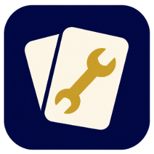
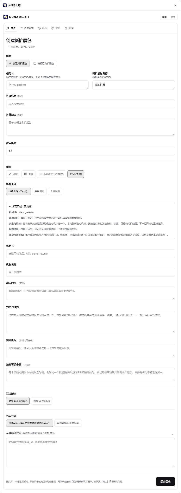

# NONAME-KIT · 无名杀 AI 扩展开发插件



NONAME-KIT 是 DeepSeek Harness（DSH）的无名杀扩展开发插件，用 AI 辅助编写武将技能、卡牌和自定义玩法代码。提交需求后，AI 会核对关键细节，等你确认方案后再开始实现。

- 搜索本地游戏源码，读取和修改已有扩展。
- 写入前检查语法和改动范围，覆盖源码前自动备份。
- 在任务列表确认效果、提交反馈，复制图片、配音和视频。
- 通过联机助手建房、检查扩展差异，并在客机同意后补传文件。



## 安装

**桌面版**：打开「插件」→「添加插件」，输入 `dsh-noname-kit` 安装。

**Web 版**：

```sh
dsh plugin --profile web add dsh-noname-kit
```

安装或更新后重启 DSH，新建会话选择「无名杀开发模式」，从输入框旁的「🛠 工坊」进入。
开发模式随插件加载，无需另外安装；DSH 0.1.6 及以下的旧宿主见[安装与更新说明](docs/usage.md#安装更新与卸载)。

命令行需要与 DSH 版本匹配的 Node.js 和 pnpm。DSH 0.2.2-rc.5 要求 Node.js 24.9.0 及以上，桌面版使用自带运行时。

## 开始使用

1. 打开工坊「设置」，保存游戏本体目录，例如 `D:\Games\Noname\resources\app`。以页面显示的「当前」路径为准，不要选到某个扩展包内。
2. 在「任务」中新建或编辑扩展，填写武将、卡牌或玩法需求，选择自动写入或手动复制。
3. 提交需求后，AI 会逐项核对，只询问会改变玩法的待定项，再给出完整的【需求理解确认】清单。回复「确认」后才开始实现。
4. 在游戏中启用扩展并测试；需要加载新代码时，完整退出并重启游戏。
5. 测试无误后逐项确认，有问题就在任务列表点「反馈」，附上现象和报错。已确认方案内的修复可以继续，玩法或范围有变化时先确认变更。

无名杀开发模式可直接提交需求，首轮即可使用开发工具，其余工具按需发现。开发上下文仅在该模式注入，不影响其他模式。静态校验无法代替游戏测试。

## 联机助手

双方安装插件，在「联机」页安装或升级游戏内的「联机助手」内核，启用后完整重启游戏。
房主创建房间，朋友输入房号加入。

在插件房间检查扩展差异，按提示补齐文件后载入游戏。结算后可点击「返回插件房间」，保留原连接进入下一局。

### 联机模式已知限制与注意事项

- **游戏版本**　建议同局玩家使用相同版本的官方无名杀，并将联机助手内核更新到同一版本。扩展文件补传目前支持 Windows 上的官方 1.11.5.2 和 1.11.6。
- **扩展加载**　联机助手默认跳过归为美化类的扩展，纯脚本包或独立机制包也可能被归入这一类。需要这些包时，可在建房前开启「联机时也加载美化类扩展」，再核对各端的加载情况。
- **扩展兼容**　载入前用「包体检」核对本局所用扩展的文件，并确认各端已启用。体检核对的是文件一致性。自制技能、卡牌、模式和机制的客机界面、操作与结算，需要进房实测。
- **补传与重启**　关闭本机自动补传后，仍可手动体检。补传提交成功后，客机须完整退出并重启无名杀。手动复制文件的一方也要重启。若提示补传结果待确认或需要恢复文件，先处理完再载入游戏。

### P2P 连接与网络限制

联机助手通过 WebRTC 建立点对点连接。用房号时，各端须使用同一信令服务器，默认使用公共信令。信令不可用时，可改用邀请码和回执码手动交换连接信息。两种方式都需要房主与客机能直连。默认配置使用 STUN 探测地址，遇到必须经 TURN 中继才能互通的网络时，连接会失败。

- **运营商 NAT、双重 NAT 或对称 NAT**　手机热点、部分小区宽带可能经过运营商级 NAT（CGNAT）。光猫和路由器都在做路由时，也可能经过两层 NAT。两端的公网端口都随连接目标变化时（常见于对称 NAT），IPv4 打洞尤其容易失败。实际结果取决于两端的端口映射和过滤规则。 [CGNAT 测试](https://www.rfc-editor.org/rfc/rfc7021.html) · [NAT 打洞说明](https://www.rfc-editor.org/rfc/rfc8656.html#section-1)
- **UDP 受限或设备隔离**　公司、学校、酒店和访客 Wi-Fi 可能限制对外 UDP，或阻止同一 Wi-Fi 下的设备互访。即使在同一地点，也要用设备之间可以互通的网络。 [无线客户端隔离说明](https://documentation.meraki.com/Wireless/Operate_and_Maintain/How_Tos/Firewall_and_Traffic_Shaping/Wireless_Client_Isolation)

如果换用邀请码后仍停在「正在建立点对点直连」，可让一方换个网络重新建房。多人局也可换一位能与其他玩家直连的人当房主。同地可用互通的局域网，异地可用双方可达的公网 IPv6，或双方已经加入且能互通的虚拟局域网。对局中切换网络可能断开当前连接。

建房、补传开关、容量限制及恢复说明见[联机使用指南](docs/usage.md#联机)。

## 文件与备份

- 扩展源码覆盖前自动备份，可在历史页查看。建立索引也会先备份；有歧义的条目会保留原文。
- 图片和配音的同名文件直接覆盖，没有自动媒体备份。视频默认不覆盖，明确允许覆盖时先备份再替换。
- 「手动复制」只控制源码交付方式；任务记录、素材复制、建立索引和内核安装等操作仍可能写入文件。
- 目录设置、素材引用和备份恢复见[详细使用说明](docs/usage.md)。

## 资料与反馈

- [详细使用说明](docs/usage.md)：目录配置、任务归档、编辑已有包、素材、联机和排障。
- [AI 开发规范](presets/noname-dev/skills/noname-extension-dev/SKILL.md)与[开发主题指南](presets/noname-dev/skills/noname-extension-dev/references/development-guide.md)。
- [提交插件问题](https://github.com/qtaik/dsh-noname-kit/issues)。开发任务的问题优先在任务列表反馈，便于保留上下文；公开日志前遮住密钥和连接凭据。

本地检查入口：`npm test`。实际玩法、游戏界面和跨网络对局仍需分别验证。

MIT License
