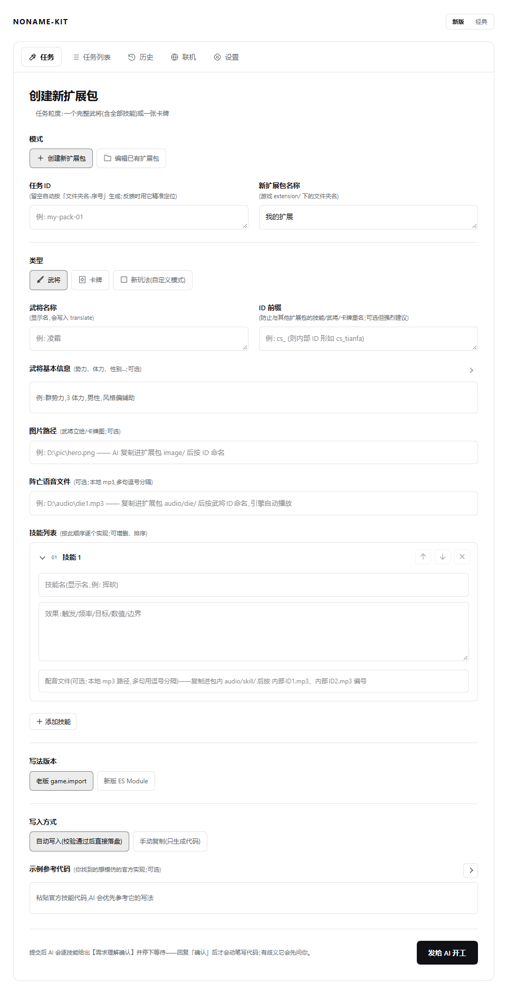
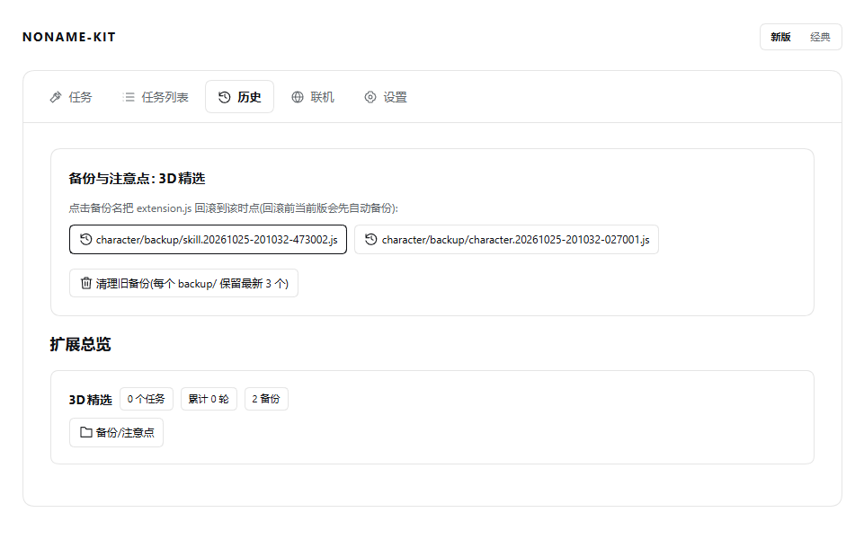
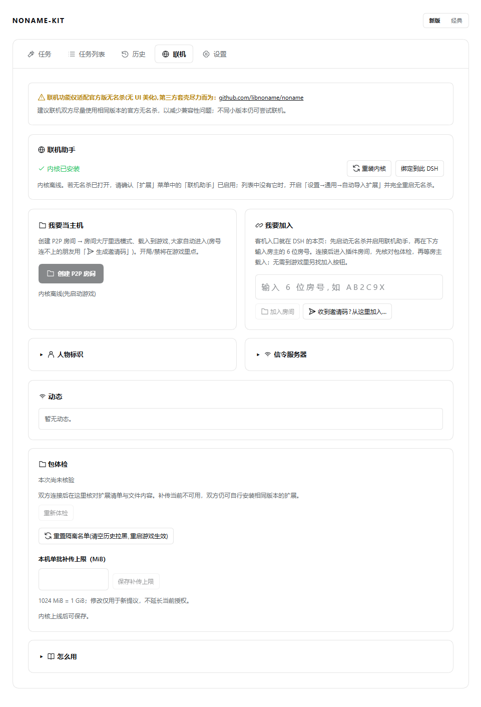
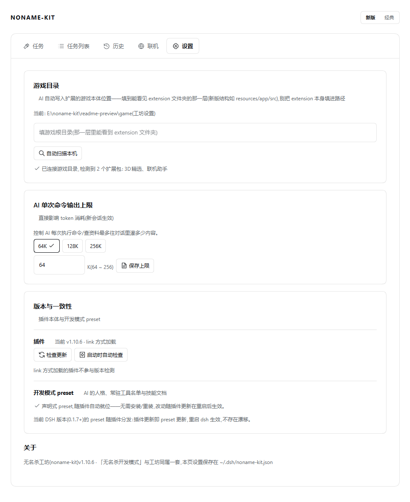

# dsh-noname-kit

无名杀扩展开发工坊,一个 DeepSeek Harness 插件。

让 AI 按规范写无名杀(Noname)的武将技能和卡牌扩展:规范注入、官方参考搜索、
静态校验、任务管理都有插件配合;扩展源码通过专用工具写入,提供改动范围检查、
防丢失检查和覆盖前自动备份。代码逻辑仍需进游戏测试。

另外还带一个跨网络联机助手:双方装本插件,就能开 P2P 房间一起玩(免公网 IP),
支持扩展体检；新版内核在插件房间中自动检查扩展差异，客机逐批确认后自动补传。





联机页截图展示内核离线时的真实入口与包体检界面。





## 安装

命令行使用需要 DeepSeek Harness、Node.js（`^22.19.0 || >=24.0.0`）和 pnpm。
桌面版使用应用自带的运行时。

```sh
dsh plugin --profile web add dsh-noname-kit
```

装完**重启 dsh**。DSH 0.1.7 起(含桌面版),「无名杀开发模式」preset 随插件自动就位;
新建会话选择这个模式,再点输入框左边的「🛠 工坊」→「⚙ 设置」配置游戏目录即可。**不用开终端。**

旧宿主(0.1.6 及以下)需在工坊「⚙ 设置」点「♻️ 重装 preset」安装开发模式,之后新建会话选择它。

旧宿主想用命令行安装 preset 也行(脚本在插件目录里,默认路径是 `C:\Users\<你的用户名>\.dsh\profiles\web\node_modules\dsh-noname-kit`):

```sh
node scripts/install-preset.mjs
```

也可从 GitHub 安装:

```sh
dsh plugin --profile web add https://github.com/qtaik/dsh-noname-kit.git
```

### 桌面版(DeepSeek Harness 桌面应用)

安装允许范围由包内 `engines.dsh` 和宿主依赖范围决定。
`dsh.compatibility.dshReleases` 另行记录精确版本的验证结论，范围声明不代表每个版本都已实测。

打开桌面版，左侧「插件」面板 →「添加插件」→ 输入 `dsh-noname-kit` → 安装。
升级社区插件请在插件面板卸载后重新安装新版,随后重启桌面版,使新插件与开发模式生效。
也可以先完全退出桌面版，再使用其安装目录中的命令行：

```sh
E:\dsh\resources\runtime\cli\bin\dsh.cmd plugin --profile desktop add dsh-noname-kit@<版本号>
```

将示例中的 `E:\dsh` 替换为实际桌面安装目录。`--profile desktop` 选择桌面配置；
`--profile web` 会安装到独立的 Web 配置。装完新建会话选「无名杀开发模式」即可
(preset 随插件自动就位，无需重装)，再到工坊「⚙ 设置」配置游戏目录。

### 兼容性与运行权限

Node.js 范围采用 [DSH 官方项目的运行要求](https://github.com/deepseek-ai/deepseek-harness/blob/1f81c047fc48fa190a683e469daa699857e9afe8/package.json)。实际运行验证使用 Windows 上的 Node.js 24.21.0，不代表范围内所有 Node.js 版本都已逐一实测。

| DSH 精确版本 | 验证结论 | 安装范围 |
|---|---|---|
| 0.2.1-rc.3 | 已验证隔离 Web Profile 的安装、启动、卸载及浏览器工坊、任务浮窗 | 允许 |
| 0.2.1-rc.2 | 已验证隔离 Web Profile 的安装、启动、卸载及实际开发工具调用 | 允许 |
| 0.2.1-rc.1 | 当前代码的独立生命周期验证未知 | 允许，仍需验证 |
| 0.2.1-alpha.5 | 未验证 | 不在安装允许范围 |

`dsh.compatibility.dshOperations` 分别记录安装、启动、卸载和版本回滚的结果；未完成的操作保持 `unknown`。`unknown` 只表示未验证,不改变包内声明的安装允许范围。


生命周期验证使用官方 Desktop 附带的 CLI 创建隔离 Web Profile，检查工坊接口、开发模式注册和卸载后重启的清理结果。该记录不包含桌面界面操作或版本降级回滚，回滚状态保持 `unknown`。

rc.3 另外验证了隔离浏览器中的工坊入口、任务浮窗、深浅主题、窄窗口和会话切换后的提交目标；提交文本与目标会话在隔离测试中核对，未发起模型请求。

- 运行依赖为 Acorn 8.19.0，用于静态解析 JavaScript；解析不会执行被读取的扩展代码。
- 工坊读取用户配置的游戏目录；扩展源码覆盖前自动备份，图片和配音通过专用工具复制到扩展目录。插件配置与任务保存在 DSH 用户目录，扩展历史与源码备份保存在对应扩展目录。图片、配音的同名目标会覆盖，不自动创建媒体备份。
- 开发模式使用宿主提供的文件、Shell 和网络工具，权限以宿主设置为准；Windows 的 Bash 适配使用本机 Git Bash。
- 更新检查访问 npm Registry 和 GitHub；联机功能访问配置的信令及连接辅助服务，并与其他玩家建立点对点连接。
- 联机内核由用户在联机页主动安装到游戏的扩展目录。卸载 DSH 插件不会自动删除游戏扩展、用户任务、历史或备份；需要时分别管理。

开发模式通过独立的 `preset-noname-dev` 入口使用宿主官方 preset 及工具组件。Bundle 的入口名和官方组件依赖保持显式声明，不覆盖官方包文件。

## 配置

重启 `dsh web` 后打开 Web UI。工坊页里没配游戏目录会先出初始化向导:填无名杀
本体目录(含 extension/ 的那层,比如标准结构 `D:\Games\noname\resources\app`、
新版结构的 `...\resources\app\src` 层),或者点「自动扫描」。配置保存在
`~/.dsh/noname-kit.json`,之后随时可以在工坊「⚙ 设置」页改。

不配置也能用:写入方式选「手动复制」,AI 只生成代码不落盘。

「⚙ 设置」中的「AI 单次命令输出上限」默认 64K,可设为 64–256K,对新建会话生效。
此项用于 Windows 开发模式的 Git Bash,标准输出和错误输出分别计限;其他工具以宿主限制为准。
版本检查与开发模式状态在同页的「版本与一致性」中查看。

## 使用

新建会话时建议选「无名杀开发模式」preset:首轮是无工具的锚定轮,之后九个无名杀工具常驻可用,
配套人格包含需求确认、区块化读写和源码核验要求,完整规范与示例按需加载。
普通会话的工具发现方式由宿主决定,需要时可通过 dev_tool_search 查找;建议使用开发模式完成整套流程。

工坊可切换「新版 / 经典」外观,并跟随宿主的深浅主题;新版表单中的描述和技能区域可收起,填写内容会保留。

「无名杀工坊」页签里建任务:选类型(武将/卡牌/🎲 新玩法自定义模式)、写法(老版
game.import / 新版 ES Module;🎲 新玩法固定新版)、填技能描述或玩法描述。🎲 新玩法
交付的是一个可用游戏主菜单进入的独立模式:填一句话核心玩法 + 自由描述玩法细节,
AI 会先探测引擎版本、把描述逐条拆成规则再给确认单。提交后 AI 会先给需求理解确认,
有歧义会先提问;收到明确的「确认」回复后才会动笔——写完自动校验、写入,并提醒进游戏测试。

游戏里发现问题就在任务列表点「🔁 反馈」,把现象或报错发给 AI;每轮反馈自动
累计轮次。新建任务在逐技能(🎲 新玩法为逐条规则)确认无误、图片也就位后自动归档
(任务里登记了配音的,还要等配音复制进包;🎲 新玩法无立绘/卡图,不强制补图);
编辑已有条目的任务不强制补图,技能全部确认且已登记配音交付齐后即归档。

配音支持:表单技能行可填本地 mp3(一句到多句都行),武将还能填阵亡语音;AI 写
技能时带 audio 字段并把文件复制进扩展包 audio/skill/、audio/die/ 目录——配音文件
只进扩展包,绝不写游戏本体目录。阵亡语音是零代码的,文件放对就生效。

已有的扩展包不用从零开始:任务模式选「📂 编辑已有扩展包」,选中扩展包后照常
走确认协议。老文件可以先点「🔨 建立区块索引」,给条目所在的 .js 文件插入锚点
注释(只加注释行、自动备份;多文件包会对每个含条目的文件逐一处理),之后 AI
按区块读写,不必每次翻整个文件。

编辑已有武将/卡牌时,选中目标就会列出它关联的技能:勾选要修改的技能、在旁边
写清改成什么,每个勾选的技能都是一个独立的任务节点,可以单独确认和反馈;
「改动描述」留给武将本身的变化(体力、护甲、名称等)。编辑任务不强制补图,
技能全部确认且已登记配音交付齐后任务即自动完成。编辑 🎲 新玩法包则没有条目下拉:直接用「模式骨架
改动」+「新增或调整的规则」描述想要的变化,AI 读完整个包的现状后逐条给确认单。

### 九个 AI 工具

| 工具 | 作用 |
|---|---|
| noname_search_reference | 只读搜索本地武将、技能和卡牌的参考实现 |
| noname_validate | 语法编译检查 + 静态规则校验(不执行代码) |
| noname_list_catalog | 只读列出官方武将、卡牌、模式及安装扩展，附来源和静态覆盖缺口 |
| noname_read_catalog | 按目录来源读取源码或条目，官方内容始终只读 |
| noname_read_extension | 读扩展当前代码(先读后改) |
| noname_write_extension | 唯一写入通道:先校验,error 拒写,覆盖前自动备份 |
| noname_skills_written | 标记技能「已写入待测试」,全部确认后自动收口(新建任务还需图片/配音就位) |
| noname_copy_images | 把本地图片复制进扩展包 image/ 目录 |
| noname_copy_audio | 把本地配音 mp3 复制进扩展包 audio/skill、audio/die 目录(不碰本体) |

参考搜索用于找实现示例,不是完整的引擎 API 索引。核对引擎函数时,开发模式要求用通用只读工具
查当前游戏源码中的真实定义、参数处理和必要直接调用,并给出文件位置;证据不足时标为待核实。
确认前可先做只读调研;需求确认是开发流程要求,静态校验不能判断技能是否完全符合玩法。

搜索和静态读取各有资源上限:参考搜索支持单文件至 5 GiB 的分块检索,每次默认 5 项、最多 10 项;
有 nextCursor 时保持 query/type 不变续搜。5 GiB 不适用于全文读取或静态解析。
目录与源码按 offset/limit 分页,按 pagination.nextOffset 续读并复用 coverage.snapshot;
源码变化后重新查询。coverage 未完成、解析失败或未命中,都不能据此认定内容不存在。
较长的手动成品可按 draftId 在同一会话中分页读取,草稿闲置 15 分钟过期,不写入游戏文件。

配置游戏目录后,守卫会检查受支持的 write/edit/bash/pwsh 等工具,拒绝识别到的游戏 extension 目录写操作。
扩展源码修改应走 noname_write_extension;读取、搜索和查看目录仍可使用通用只读工具。

## 🌐 联机助手

工坊「🌐 联机」页签里的另一个功能:跨网络开 P2P 房间一起玩,免公网 IP。双方都
装本插件即可——游戏里装一个无头的「内核」负责联机(联机页一键安装)。

- **建房**:使用「创建 P2P 房间」获取 6 位房号，朋友输入房号加入；公共信令不可用时，可直接选择「邀请码建房」，朋友生成回执码发回房主后建立连接。邀请码建房不连接公共 MQTT 信令，仍受双方网络条件影响。
  两种入口共用插件房间、包体检及载入流程；已有房间可继续生成邀请码。邀请码房间可稍后「启用房号」，发布失败会保留已有邀请和连接。人满自动排队，有空位时按大厅及当前对局状态安排入座。
- **结算后返回插件房间**:在结算页点击「返回插件房间」。双方完成本局末帧确认后，关闭本局游戏窗口，保留原连接并停在插件房间；房主可以调整模式，再点「载入到游戏」，客人自动跟随。每局使用新文档、新 init 和座位；不自动重连或重新协商。新文档会重新核对模式配置和文件事务，失败会明确提示。
- **自由选将**:双方升级内核并重启游戏，在游戏房间设置中开启后，常规选将窗口可按势力、武将包筛选，并搜索武将名称或 ID。候选仍以本局启用包和禁将规则为准；点将单挑沿用原生分类界面，对决 2v2 的队友推荐窗口保留原生布局。
- **包体检**:大厅、排队及入局后均向当前请求连接回复扩展差异;退出或断连后,
  旧连接的检查计时与迟到结果失效。体检卡跟随最近发起的检查；旧内核无编号回复仅在新连接首次单次检查时可信，后续无法关联的回复显示“本次尚未核验”，需升级联机助手或重新连接后核对。双方使用新版内核时，载入游戏前即可检查。
- **自动补传**:在插件房间中,缺失或同名文件有差异的扩展可生成本批请求;客机逐批同意后自动接收、整批校验并落盘,成功后自动保存扩展启用设置。补传前须关闭本目录的对局游戏窗口。完成后客机须完整退出并重启无名杀,才会载入新代码;Ctrl+R 不能代替完整重启,房主无需因此重启。若提示自动启用未确认,客机应检查并手动启用所列扩展,再完整重启,无需重新下载。
- **重新传输**:自动流程未触发或需要重试时,房主可点「重新传输」;多人按客机逐个申请、串行处理,每次都要重新体检并取得客机对本批的同意。中断后重传整批文件,不提供断点续传;若提交结果待确认或需要文件恢复,先按界面提示核对或恢复,再决定后续操作。
- **主客进度**:房主显示客机已确认接收的字节进度,客机显示已接收至暂存区的进度。100% 后还须等待整批校验、提交与启用结果,不能只看进度判断补传完成;房主的多人补包总览会按客机显示独立阶段和进度。
- **补传容量与时限**:支持每批最多 64 个扩展、4096 个文件,硬上限 1 GiB（1024 MiB）。本机单批容量默认 300 MiB,在联机页或插件房间浮窗的「包体检」卡中设为 1–1024 MiB;内核上线且没有进行中的补传、授权或恢复时才可保存。已保存的较低限额不会自动调高,批次需同时符合双方限额。时限按本批大小确定,从提议发出起计算（含客机确认等待）,最长 15 分钟;到期停止,进度、重复消息和修改容量都不会延长当前授权。新版补传限 Windows 上的官方 1.11.5.2 / 1.11.6;内置内容及仅未启用但文件一致的扩展不补传。双方都须升级联机内核并完整重启,旧协议不降级补传。
- **内核**:联机页点「📦 安装内核」装进游戏 extension/ 目录,再到游戏「扩展」菜单
  给「联机助手」点「启」并完整退出、重启游戏。升级插件后点「⬆️ 升级内核」并完整重启;
  建议双方使用相同的最新内核,补传能力以当前连接实际协商的协议为准。
  若内核绑定到另一 DSH,或本机绑定缺失、失效,可点「绑定到此 DSH」更新绑定;已运行的旧内核仍须完整退出并重启无名杀。

本插件仅适配官方版无名杀;对局数据是点对点直连,信令服务器
只负责牵线。

建议联机双方尽量使用相同版本的官方无名杀，以减少兼容性问题；不同小版本仍可尝试联机。
局中解散大厅只关闭房间入口及未入局连接;正在进行的对局继续使用原生结算,
已入局连接继续保留；结算后仍可返回原连接的插件房间，选择模式并再次载入。

## 「无名杀开发模式」preset

presets/noname-dev 是一个 Zero-Anchored 架构的 agent preset(参考
xiaobright/dsh-anchored-standard,MIT):首轮不开放任何工具,之后常驻集只保留
shell、编辑器和上述工具,web 等重工具按需解锁;完整开发规范走 skill 按需
加载。

## 更新

工坊「⚙ 设置」中的「版本与一致性」,两块各管一件事:

- **插件**:显示当前版本,有新版本时给出精确版本的升级命令(只提示,不自动更新)。
  按页面提示选择安装配置:Web 使用 `--profile web`,桌面使用 `--profile desktop`;
  执行后重启 DSH。link 方式加载的插件不参与版本检测(加载的就是源码目录本身)。
  桌面版也可在官方「插件」面板里卸载后重装来升级。
- **开发模式 preset**:支持声明式 preset 的宿主随插件加载开发模式,更新插件并重启 DSH 后生效,
  无需安装或重装。旧宿主使用独立副本;检测到与插件自带内容不一致时,点「♻️ 重装 preset」,
  覆盖前自动备份成 `noname-dev.bak-<时间戳>`,装完对新建会话生效。

检测到插件新版本,或旧宿主 preset 缺失、不一致时,输入条上的 🛠 按钮会带一个小红点。版本信息从 npm registry 和
GitHub tag 取,查不通只显示一行「检查失败」,不影响使用;「启动时自动检查」可以在
设置页关掉,改成手动点。

## 已知限制

- 新建会话发第一条消息前,顶部页签栏不显示——这是 DSH 空白会话的官方设计,
  发一条消息就出来了。
- 工坊 HTTP API 仅接受本机发起的请求。
- 运行期错误(逻辑对不对)插件管不了,仍要进游戏验证后走「问题反馈」。
- 引擎默认不去扩展的 image/ 子目录找立绘:武将定义里要显式写 img,卡牌定义写 image
  并按卡图写法配 fullimage: true;工坊的任务流程和规范文本里都有说明。
- 技能配音的 audio 字段必须写扩展包内路径(audio: "ext:包名/audio/skill:句数"),
  不带 ext: 的写法会被校验器警告(那会去游戏本体 audio/ 目录找文件);阵亡语音
  则是零代码,mp3 放进包内 audio/die/ 即生效。
- 新式 ES Module 多文件扩展包(如懒人包预装的英雄杀、杀海拾遗)已支持区块化
  编辑:条目在子目录模块里(`const character = {…}` 形态)也能识别,读写按文件
  进行。仍不支持运行时赋值形态(`pack.skill.xxx = {}`,条目没有字面量可锚)。

## 测试

```sh
npm test
```

标准入口只自动发现 scripts 顶层的 test-*.mjs（排除 test-all.mjs,不递归子目录）,按文件名排序后串行运行;
任一套件失败会返回非零退出码。套件和断言统计以实际运行输出为准。现有脚本覆盖以下类别:

| 类别 | 主要检查 |
|---|---|
| 开发任务 | 任务状态、逐技能确认与反馈、再次测试、图片与配音交付条件 |
| 解析与检索 | 静态模块及导出解析、内容目录与来源、大文件和分块搜索、续搜与分页、手动成品读取 |
| 写入与媒体 | 区块拼装、全文改动范围与保真、通用工具写入守卫、备份回滚、配音复制与目标校验 |
| 配置、preset 与会话界面 | 游戏目录探测、版本检查、preset 安装与发现、Shell 适配、表单与会话提交、工具发现与输出 |
| 单人隔离与联机生命周期 | 单人启动隔离契约、内核和桥绑定、房间与连接状态、包体检、结算返回、下一局及角色切换 |
| 补传与事务恢复 | 自动和手动补传、客机逐批授权、多客机进度、容量和时限、整批校验提交、扩展启用及中断恢复 |

以下只是单项运行示例,其余符合发现规则的套件也会由 npm test 运行:

```sh
node scripts/test-tasks.mjs              # 任务状态与交付条件
node scripts/test-reference.mjs          # 参考搜索
node scripts/test-catalog.mjs            # 只读内容目录
node scripts/test-auto-transfer-ui.mjs   # 自动补传界面
```

这些脚本包含静态检查、隔离模拟和本机文件事务回归。scripts/official 下的官方游戏实机探针与矩阵
不在上述自动发现范围内,需要准备独立游戏副本后另行运行。跨机/跨网络对局,以及真实模型从新会话
完成完整开发或审核流程,也需要分别验证;npm test 的结果不能代替这些验证。

## 反馈

插件有问题欢迎提 [issue](https://github.com/qtaik/dsh-noname-kit/issues),附上复现步骤和报错更好。

## 杂谈

其实在 agent 这个概念兴起之前,就已经在用 AI 写复杂代码了——从 ChatGPT-3 一路用到
4.5。那时候的办法:建一个自定义智能体,把代码规范传进知识库,写之前再去官方源码里
找类似的实现粘进对话当参考,AI 写出来的东西才像样。这个插件,本质上是把那套网页版
习惯搬了过来:知识库变成了常驻注入的规范文本,手动粘参考变成了 noname_search_reference
自动搜索,每次手动调教变成了需求确认协议、静态校验和写入守卫。

之所以选 DSH,一是它可塑性高,能自定义地强制约束 AI 的行为;二是不像网页版那样
每次开新会话都得重新教一遍规矩,规范和工具由 preset 和插件常驻注入,上下文不浪费。
测试模型用的是 deepseek-v4.1-flash。
如果你也在玩无名杀、也在用 DeepSeek Harness,欢迎装上试试——把想要的武将或卡牌
用一句话描述给 AI,剩下的交给流程。用得顺手点个 star;遇到问题欢迎提 issue;
写出了有趣的扩展,更欢迎回来说一声。写扩展这件事,从翻代码、粘对话,到动动嘴
就行——工具已经准备好了,就等你了。

## 卸载

```sh
dsh plugin --profile web remove dsh-noname-kit
```

联机内核(游戏 extension/ 目录里的「联机助手」)不会被自动删除,不用了在游戏
「扩展」菜单里删掉即可。

MIT License
